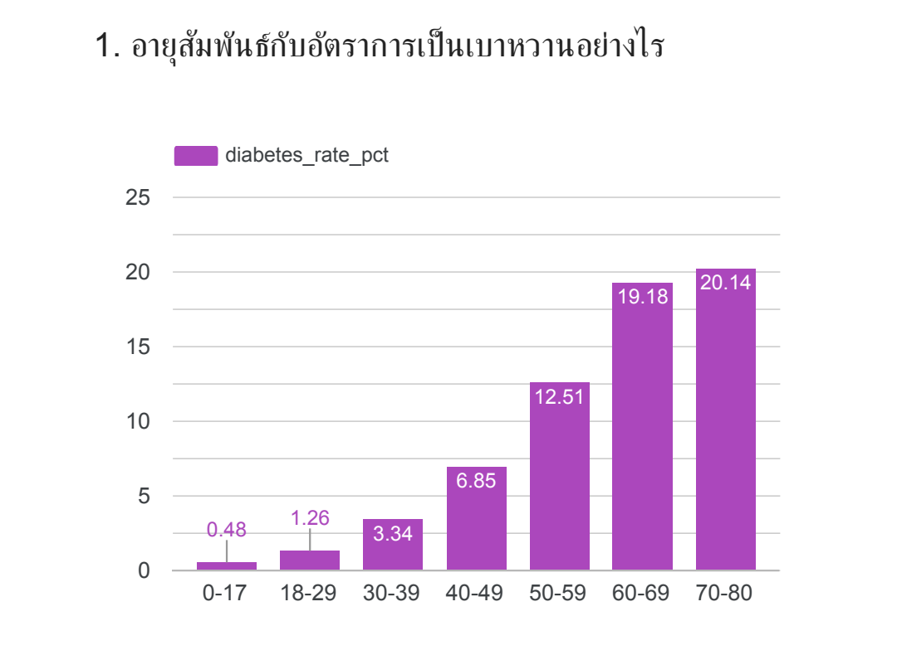
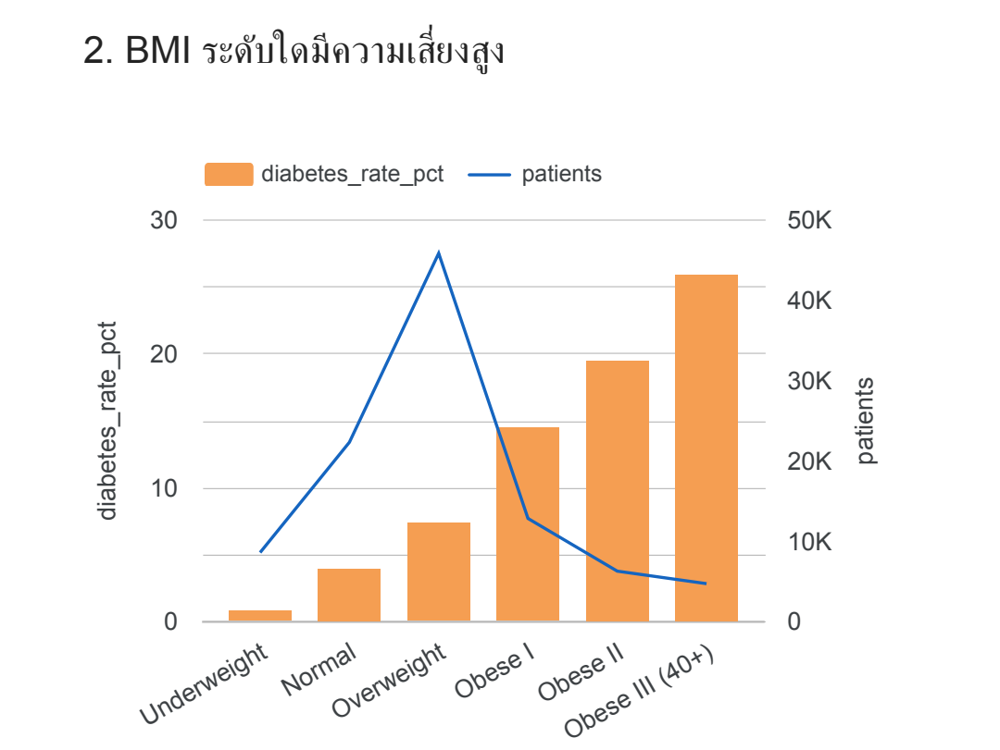
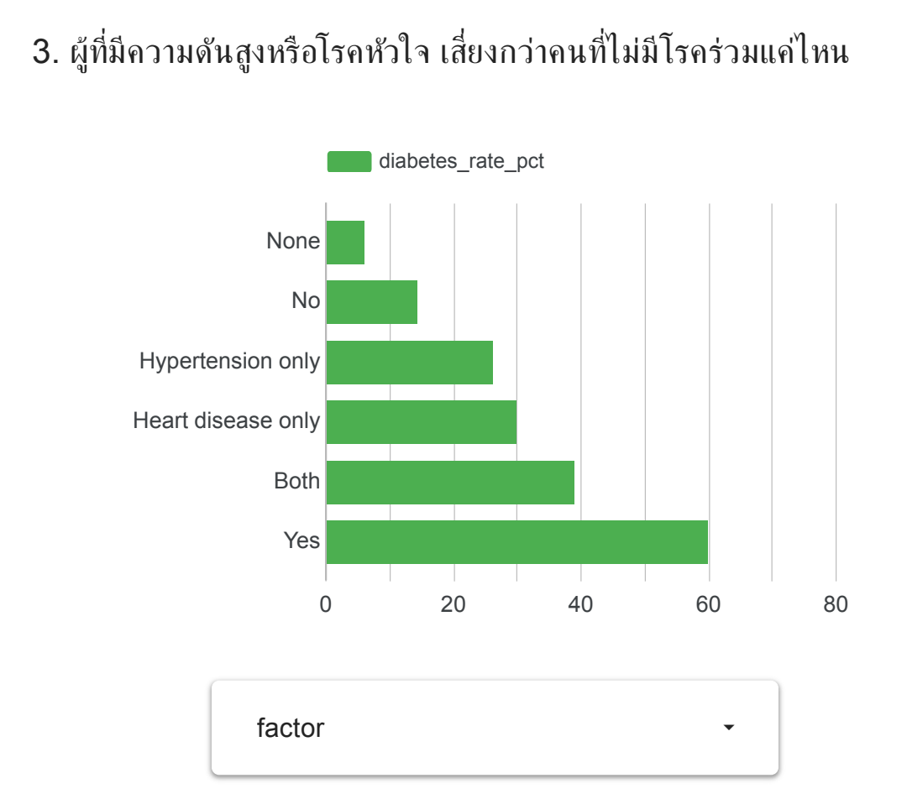
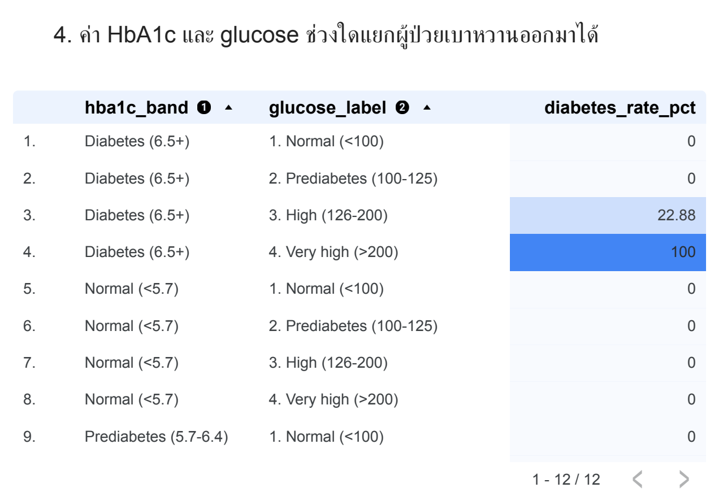
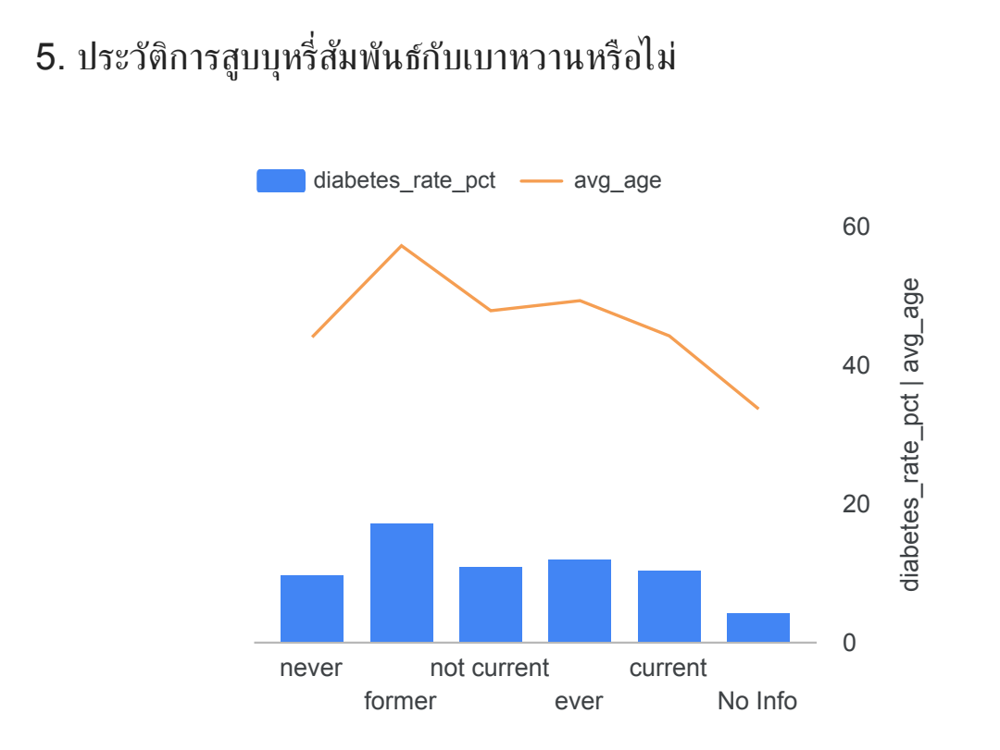

# รายงานโปรเจกต์: Automated Data Pipeline วิเคราะห์ปัจจัยเสี่ยงโรคเบาหวาน (Kaggle Data Edition)

> **สมาชิก:** [1670904349 ภูรี สิมมา], [1670904174 ญาณากร ยอดอุดม], [1670901552 เอกรัตน์ จิตรบรรจง] · **วันนำเสนอ:** 21 พฤศจิกายน 2569
>
> **Data Studio Report:** [ใส่ลิงก์] · **GitHub:** https://github.com/yanakornyodu-glitch/diabetes-pipeline

---

## 1. ที่มาและความสนใจ

โรคเบาหวานเป็นโรคเรื้อรังที่พบบ่อย และมักไม่มีอาการชัดเจนในช่วงแรก ถ้ารู้ว่าคนกลุ่มไหนมีความเสี่ยงสูง ก็จะคัดกรองได้ตรงกลุ่มและเริ่มป้องกันได้เร็วขึ้น
กลุ่มจึงเลือกชุดข้อมูลสุขภาพผู้ป่วยจาก Kaggle ชื่อไฟล์ **`diabetes_dataset_with_notes.csv`** ([ใส่ลิงก์หน้า dataset บน Kaggle]) เพื่อหาว่าปัจจัยใดสัมพันธ์กับการเป็นเบาหวานมากที่สุด

เหตุผลที่เลือกชุดข้อมูลนี้

- **ขนาดใหญ่พอ:** มี 100,000 แถว 1 แถวคือผู้ป่วย 1 คนในสหรัฐอเมริกา จึงต้องคิดเรื่องขนาดข้อมูลจริงก่อนส่งขึ้น Google Sheets (ข้อจำกัด cell)
- **ตัวแปรหลายมิติ:** มีข้อมูลประชากร (อายุ เพศ เชื้อชาติ รัฐ), โรคร่วม, พฤติกรรมการสูบบุหรี่, ค่าตรวจทางห้องแล็บ และบันทึกแพทย์แบบข้อความอิสระ
- **มีตัวแปรเป้าหมายชัดเจน:** คอลัมน์ `diabetes` (0/1) คำนวณอัตราการเป็นเบาหวานของแต่ละกลุ่มได้ทันที

### โครงสร้างข้อมูล (17 คอลัมน์)

| คอลัมน์ | ชนิด | ความหมาย / ข้อสังเกต |
|---|---|---|
| `year` | int | ปีที่บันทึก 2015–2022 (ราว 80% เป็นปี 2019) |
| `gender` | str | Female, Male, Other (18 คน) |
| `age` | float | 0.08–80 ปี (เด็กเล็กมีอายุเป็นทศนิยม) |
| `location` | str | 50 รัฐ + DC + Guam, Puerto Rico, Virgin Islands + ค่า "United States" ที่ไม่ใช่รัฐ |
| `race:AfricanAmerican`, `race:Asian`, `race:Caucasian`, `race:Hispanic`, `race:Other` | 0/1 | เชื้อชาติแบบ one-hot (แต่ละแถวมีค่า 1 เพียงคอลัมน์เดียว) |
| `hypertension`, `heart_disease` | 0/1 | ความดันโลหิตสูง / โรคหัวใจ |
| `smoking_history` | str | never, former, current, not current, ever, No Info |
| `bmi` | float | ดัชนีมวลกาย 10.01–95.69 |
| `hbA1c_level` | float | ระดับน้ำตาลสะสม 3.5–9.0 % |
| `blood_glucose_level` | int | ระดับน้ำตาลในเลือด 80–300 mg/dL |
| `diabetes` | 0/1 | **ตัวแปรเป้าหมาย** (อัตรารวม 8.5%) |
| `clinical_notes` | str | บันทึกแพทย์ ยาว 18–488 ตัวอักษร |

### คุณภาพข้อมูลที่ตรวจพบ

- ไม่มีค่าว่าง (missing) ในไฟล์ต้นฉบับ แต่โค้ดเขียนรองรับไว้ เผื่ออัปเดตข้อมูลแล้วมีค่าว่าง
- มี **แถวซ้ำทุกคอลัมน์ 14 แถว**
- ชื่อคอลัมน์มีเครื่องหมาย `:` (เช่น `race:Asian`) และตัวพิมพ์ใหญ่ปน (`hbA1c_level`) ทำให้ใช้ใน SQL และ Data Studio ไม่สะดวก
- `location` มีค่า "United States" ซึ่งไม่ใช่รัฐ ต้องแยกออกเมื่อสรุปรายรัฐ
- `smoking_history` เป็น "No Info" ถึง 36%

---

## 2. สถาปัตยกรรมข้อมูล

```
┌──────────────┐  ingest.py   ┌───────────────────────────── PostgreSQL 16 (Docker) ─────────────────────────────┐
│ Kaggle CSV   │ ───────────▶ │ schema raw_data                         schema production                         │
│ (100k rows)  │  pandas +    │ diabetes_dataset_with_notes ─transform.py─▶ patients_clean + 12 ตารางสรุป           │
└──────────────┘  SQLAlchemy  │ (ข้อมูลดิบตามต้นฉบับ)          (pandas)    (ข้อมูลที่ clean แล้ว + aggregate)          │
                              └──────────────────────────────────────────────────┬──────────────────────────────┘
                                                                                 │ publish.py (gspread + gspread-dataframe)
                                                                                 ▼  ส่งเฉพาะ 12 ตารางสรุป (~32,000 cells)
                                                                       ┌────────────────────┐        ┌──────────────────────────┐
                                                                       │ Google Sheets      │ ─────▶ │ Data Studio Dashboard     │
                                                                       │ 1 ตาราง = 1 sheet   │ connector│                          │
                                                                       └────────────────────┘        └──────────────────────────┘

                          run_pipeline.py  =  ingest → transform → publish  ด้วยคำสั่งเดียว
```

หลักการออกแบบ

1. **แยกชั้นข้อมูล (layered):** ชั้น `raw_data` เก็บข้อมูลตามต้นฉบับทุกตัวอักษร ส่วน `production` เก็บข้อมูลที่ผ่านการแปลงแล้ว ถ้าแก้ตรรกะการแปลง ก็รัน transform ใหม่จาก raw ได้โดยไม่ต้องโหลดไฟล์ซ้ำ
2. **Full refresh / idempotent:** ทุกขั้นเขียนทับตารางเดิม (`if_exists="replace"`) และเขียนทับ worksheet เดิม รันกี่ครั้งก็ได้ผลเหมือนเดิม ไม่มีข้อมูลซ้ำสะสม
3. **Aggregate ก่อนขึ้นคลาวด์:** ตารางระดับผู้ป่วย 99,986 แถวพร้อมบันทึกแพทย์อยู่ใน PostgreSQL เท่านั้น ส่งขึ้น Google Sheets เฉพาะตารางสรุป เพื่อไม่ให้ชนลิมิต cell และไม่ให้ข้อความทางการแพทย์รายบุคคลออกไปบนคลาวด์
4. **แยกค่าตั้งค่าออกจากโค้ด:** รหัสผ่านฐานข้อมูล, พอร์ต และ Spreadsheet ID อยู่ในไฟล์ `.env` ส่วน key ของ Google อยู่ใน `credentials.json` ทั้งสองไฟล์อยู่ใน `.gitignore`

---

## 3. เครื่องมือที่ใช้และขั้นตอนการทำงาน

| ชั้น | เครื่องมือ | หน้าที่ |
|---|---|---|
| Source | Kaggle (CSV) | แหล่งข้อมูลต้นทาง |
| Ingestion & Load | Python, pandas, SQLAlchemy, psycopg2 | อ่าน CSV แล้วโหลดเข้า PostgreSQL |
| Data Warehouse | PostgreSQL 16 บน Docker (`docker-compose.yml`) | เก็บข้อมูล 2 ชั้น: `raw_data` / `production` |
| Transformation | pandas, NumPy | Cleaning, Feature Engineering, Joining, Aggregation |
| Publish | gspread, gspread-dataframe, google-auth | เขียน DataFrame ลง Google Sheets |
| Automation | `run_pipeline.py` | รันทุกขั้นด้วยคำสั่งเดียว |
| Visualization | Data Studio | Dashboard เชื่อมกับ Google Sheets |
| Config | python-dotenv (`.env`) | แยกค่าตั้งค่าออกจากโค้ด |

### 3.1 Data Warehouse: `docker-compose.yml`

- ใช้ image `postgres:16` ชื่อ container `diabetes-postgres` user/database อ่านจาก `.env` (ค่าเริ่มต้น `pipeline` / `diabetes`)
- มี volume `pgdata` เก็บข้อมูลถาวร ปิดหรือเปิด container ใหม่ข้อมูลก็ไม่หาย
- มี healthcheck (`pg_isready`) ใช้ตรวจว่าฐานข้อมูลพร้อมก่อนรัน pipeline
- พอร์ตตั้งได้ผ่าน `POSTGRES_PORT` ถ้าเครื่องมี Postgres ตัวอื่นใช้พอร์ต 5432 อยู่ ให้เปลี่ยนเป็น 5433

### 3.2 Extraction & Load: `ingest.py`

1. ตรวจว่ามีไฟล์ `data/diabetes_dataset_with_notes.csv` ถ้าไม่มีจะหยุดและบอกให้ดาวน์โหลดจาก Kaggle
2. อ่าน CSV ด้วย `pd.read_csv` ได้ 100,000 แถว × 17 คอลัมน์
3. สร้าง schema `raw_data` (`CREATE SCHEMA IF NOT EXISTS`)
4. เขียนด้วย `DataFrame.to_sql` ลงตาราง **`raw_data.diabetes_dataset_with_notes`** ตั้งชื่อตามไฟล์ Kaggle ตามที่โจทย์กำหนด ไม่แก้ไขข้อมูลใดๆ ในขั้นนี้

### 3.3 Transformation: `transform.py`

อ่าน `raw_data.diabetes_dataset_with_notes` ด้วย `pd.read_sql_table` แล้วส่งผ่านฟังก์ชันแบบ pure 3 ตัว ทั้งสามตัวรับ DataFrame และคืน DataFrame จึงทดสอบได้โดยไม่ต้องต่อฐานข้อมูล

**(1) Cleaning: `clean(df)`**

| ขั้นตอน | วิธีทำ | ผล |
|---|---|---|
| เปลี่ยนชื่อคอลัมน์ | เป็น snake_case เช่น `race:Asian` → `race_asian`, `hbA1c_level` → `hba1c_level` | ใช้ใน SQL / Data Studio ได้สะดวก |
| ทำความสะอาดข้อความ | `str.strip()` ตัดช่องว่างหน้าหลัง | ค่าหมวดหมู่ไม่แตกเป็นหลายค่าเพราะช่องว่าง |
| แก้ Data Type | `pd.to_numeric(errors="coerce")` ค่าที่ผิดรูปแบบกลายเป็น NaN แล้วแปลงเป็น int / float ให้ถูกชนิด | ชนิดข้อมูลถูกต้องทุกคอลัมน์ |
| เติม Missing Values | ตัวเลขเติมด้วย median; หมวดหมู่เติมด้วย label (`gender`/`location` = "Unknown", `smoking_history` = "No Info", `clinical_notes` = "") | ไม่มีค่าว่างเหลือ |
| ตัดค่าที่เป็นไปไม่ได้ | อายุ 0–120, BMI 10–100, HbA1c 3–20, glucose 20–1000, คอลัมน์ 0/1 ต้องเป็น 0 หรือ 1 เท่านั้น | ไม่พบค่าผิดปกติในชุดนี้ |
| ลบแถวซ้ำ | `drop_duplicates()` | ลบ **14 แถว** เหลือ **99,986 แถว** |

**(2) Feature Engineering: `add_features(df)`**

| คอลัมน์ใหม่ | วิธีคำนวณ |
|---|---|
| `patient_id` | เลขลำดับผู้ป่วย 1…99,986 |
| `race` | รวม one-hot 5 คอลัมน์เป็นคอลัมน์เดียว (African American, Asian, Caucasian, Hispanic, Other) |
| `age_group` | 0-17, 18-29, 30-39, 40-49, 50-59, 60-69, 70-80 |
| `bmi_category` | เกณฑ์ WHO: Underweight (<18.5), Normal, Overweight (25+), Obese I (30+), Obese II (35+), Obese III (40+) |
| `hba1c_band` | เกณฑ์ ADA: Normal (<5.7), Prediabetes (5.7–6.4), Diabetes (6.5+) |
| `glucose_band` | Normal (<100), Prediabetes (100–125), High (126–200), Very high (>200) |
| `smoking_group` | Never / Past (former, not current, ever) / Current / Unknown ได้มาจากการ join ตาราง mapping |
| `comorbidity_group` | None / Hypertension only / Heart disease only / Both |
| `risk_marker_count` | จำนวนปัจจัยเสี่ยง 0–6 ข้อ: อายุ ≥ 45, BMI ≥ 30, ความดันสูง, โรคหัวใจ, HbA1c ≥ 5.7, glucose ≥ 126 |
| `is_us_state` | `False` เมื่อ `location` = "United States" (ไม่ใช่รัฐ ใช้กรองออกเมื่อสรุปรายรัฐ) |
| `diabetes_status` | "Diabetic" / "Non-diabetic" ใช้เป็น label ในกราฟ |
| `note_length` | ความยาวบันทึกแพทย์ (ตัวอักษร) |

**(3) Joining**

ชุดข้อมูลนี้มีไฟล์เดียว จึงสาธิตการรวมตารางด้วย 2 วิธี

- **`merge` (join):** สร้างตาราง mapping `SMOKING_MAP` (`smoking_history` → `smoking_group`, ลำดับการเรียง) แล้ว left join เข้ากับตารางผู้ป่วยและตารางสรุปการสูบบุหรี่
- **`concat` (union):** สรุปอัตราการเป็นเบาหวานแยก 3 มุม ได้แก่ ความดันสูง, โรคหัวใจ และกลุ่มโรคร่วม แล้วนำมาต่อกันเป็นตารางยาวตารางเดียว (`diabetes_by_comorbidity`) ที่ Data Studio กรองด้วยคอลัมน์ `factor` ได้

**(4) Aggregation: `build_tables(df)`**

ใช้ฟังก์ชันกลาง `rate_table()` (`groupby` + `agg`) สรุปทุกมิติด้วยคอลัมน์ชุดเดียวกัน ได้แก่ `patients`, `diabetics`, `diabetes_rate_pct`, `share_of_patients_pct`, `share_of_diabetics_pct`, `avg_age`, `avg_bmi`, `avg_hba1c`, `avg_glucose` และ `sort_order` สำหรับเรียงแกนในกราฟ

**ตารางผลลัพธ์ใน schema `production`**

| ตาราง | แถว | เนื้อหา | ส่งขึ้น Sheets | ใช้ใน Dashboard |
|---|---|---|---|---|
| `patients_clean` | 99,986 | ข้อมูลระดับผู้ป่วยที่ clean แล้วพร้อม features | ไม่ส่ง | — |
| `diabetes_by_age_group` | 7 | อัตราตามกลุ่มอายุ | ส่ง | **Q1** |
| `diabetes_by_bmi_category` | 6 | อัตราตาม BMI | ส่ง | **Q2** |
| `diabetes_by_comorbidity` | 8 | อัตราตามโรคร่วม (ตารางยาว กรองด้วย `factor`) | ส่ง | **Q3** |
| `diabetes_by_lab_matrix` | 12 | HbA1c × glucose (3 × 4) สำหรับ heatmap | ส่ง | **Q4** |
| `diabetes_by_smoking` | 6 | อัตราตามประวัติการสูบบุหรี่ + อายุเฉลี่ย | ส่ง | **Q5** |
| `kpi_summary` | 1 | KPI รวม (จำนวนผู้ป่วย, อัตรารวม, ค่าเฉลี่ย) | ส่ง | สำรอง |
| `diabetes_by_hba1c_band` | 3 | อัตราตามช่วง HbA1c | ส่ง | สำรอง |
| `diabetes_by_glucose_band` | 4 | อัตราตามช่วง glucose | ส่ง | สำรอง |
| `lab_scatter_sample` | 5,000 | สุ่มกลุ่มละ 2,500 คน สำหรับ scatter plot | ส่ง | สำรอง |
| `diabetes_by_state` | 54 | อัตรารายรัฐ + อันดับ + ธง `small_sample` (n < 1,000) | ส่ง | สำรอง |
| `diabetes_by_demographic` | 83 | อายุ × เพศ × เชื้อชาติ | ส่ง | สำรอง |
| `diabetes_by_risk_markers` | 7 | อัตราตามจำนวนปัจจัยเสี่ยง 0–6 | ส่ง | สำรอง |

ตาราง "สำรอง" ถูกสร้างและส่งขึ้น Google Sheets ด้วยเพื่อใช้ตรวจสอบตัวเลขและต่อยอด Dashboard ในอนาคต แต่ Dashboard ฉบับนี้ใช้เฉพาะ 5 ตารางที่ตอบคำถาม Q1–Q5

### 3.4 Publication: `publish.py`

1. อ่านทุกตารางใน `production` ด้วย `pd.read_sql_table` ยกเว้น `patients_clean`
2. **ตรวจขนาดก่อนส่ง:** รวมได้ **32,419 cells** จากลิมิต 10,000,000 cells ของ Google Sheets ถ้าเกินลิมิต สคริปต์จะหยุดก่อนส่ง
3. ยืนยันตัวตนด้วย service account (`gspread.service_account`) และใช้ `BackOffHTTPClient` ให้ส่งใหม่อัตโนมัติเมื่อชน quota (APIError 429)
4. เปิด spreadsheet ด้วย `SPREADSHEET_ID` จาก `.env` แล้ววนเขียนทีละตาราง: ถ้ายังไม่มี worksheet ชื่อตรงกันก็สร้างใหม่ ถ้ามีแล้วก็ปรับขนาดให้พอดีกับตาราง
5. เขียนด้วย `set_with_dataframe` (gspread-dataframe) หลังแปลง NaN เป็นค่าว่างและ boolean เป็น TRUE/FALSE ให้ Sheets อ่านได้

### 3.5 Automation: `run_pipeline.py`

```bash
python run_pipeline.py                 # ingest → transform → publish
python run_pipeline.py --skip-publish  # ทดสอบเฉพาะฝั่ง local
```

เรียก `ingest.main()` → `transform.main()` → `publish.main()` ตามลำดับ และพิมพ์เวลาที่ใช้ในแต่ละขั้น ถ้าขั้นไหนผิดพลาดจะหยุดทันทีโดยไม่ทำขั้นถัดไป
เวลาที่วัดได้จริง: ingest ~5 วินาที, transform ~9 วินาที, publish ~15 วินาที **รวมประมาณ 30 วินาที**

---

## 4. การตั้งค่า Google API Credentials

1. เข้า https://console.cloud.google.com → สร้าง **Project** ใหม่
2. ไปที่ **APIs & Services → Library** → ค้นหาและกด **Enable** ทั้ง **Google Sheets API** และ **Google Drive API** (gspread ใช้ Drive API ค้นหาไฟล์)
3. ไปที่ **APIs & Services → Credentials → Create Credentials → Service account** → ตั้งชื่อ (เช่น `pipeline-bot`) → Done
4. คลิก service account ที่สร้าง → แท็บ **Keys → Add key → Create new key → JSON** → ไฟล์ key จะถูกดาวน์โหลดลงเครื่อง
5. เปลี่ยนชื่อไฟล์เป็น `credentials.json` แล้ววางไว้ที่ root ของโปรเจกต์
6. สร้าง Google Sheet ใหม่ → กด **Share** → ใส่อีเมลของ service account (ค่า `client_email` ในไฟล์ `credentials.json` รูปแบบ `...@<project>.iam.gserviceaccount.com`) → ให้สิทธิ์ **Editor**
7. คัดลอก Spreadsheet ID จาก URL `https://docs.google.com/spreadsheets/d/<ID>/edit` ไปใส่ใน `.env` บรรทัด `SPREADSHEET_ID=<ID>`
8. **ความปลอดภัย:** `credentials.json` และ `.env` อยู่ใน `.gitignore` แล้ว **ห้าม commit ขึ้น GitHub เด็ดขาด** เพราะใครได้ key ไปก็เข้าถึงชีตที่แชร์กับ service account ได้ทั้งหมด ถ้าเผลอ commit ไปแล้ว ให้ลบ key ใน Cloud Console ทันทีแล้วสร้างใหม่

---

## 5. คำถามทางธุรกิจและ Dashboard

Dashboard มี 5 visualization ตอบคำถาม 5 ข้อ ข้อละ 1 กราฟ (ตามที่โจทย์กำหนด)

| # | คำถาม | กราฟบน Dashboard | worksheet |
|---|---|---|---|
| Q1 | อายุสัมพันธ์กับอัตราการเป็นเบาหวานอย่างไร | Column chart แสดงค่าบนแท่ง | `diabetes_by_age_group` |
| Q2 | BMI ระดับใดมีความเสี่ยงสูง | Combo chart: แท่ง = อัตราเบาหวาน, เส้น = จำนวนผู้ป่วย | `diabetes_by_bmi_category` |
| Q3 | ผู้ที่มีความดันสูงหรือโรคหัวใจ เสี่ยงกว่าคนที่ไม่มีโรคร่วมแค่ไหน | Bar chart แนวนอน + ตัวกรอง `factor` | `diabetes_by_comorbidity` |
| Q4 | ค่า HbA1c และ glucose ช่วงใดแยกผู้ป่วยเบาหวานออกมาได้ | ตาราง HbA1c × glucose พร้อม heatmap (ระบายสีตามอัตรา) | `diabetes_by_lab_matrix` |
| Q5 | ประวัติการสูบบุหรี่สัมพันธ์กับเบาหวานหรือไม่ | Combo chart: แท่ง = อัตราเบาหวาน, เส้น = อายุเฉลี่ย | `diabetes_by_smoking` |

ข้อตั้งค่าใน Data Studio ที่ควรรู้

- เรียงแกนด้วยฟิลด์ `sort_order` แทนการเรียงตามตัวอักษร เพื่อให้กลุ่มอายุหรือ BMI เรียงถูกลำดับ
- Q3 ใช้ตัวกรอง `factor` เลือกดูทีละมุม (ความดันสูง / โรคหัวใจ / กลุ่มโรคร่วม) เพราะตารางเป็นแบบยาวที่รวม 3 มุมไว้ด้วยกัน
- Q4 ใช้ตารางที่ระบายสีตามค่า (heatmap) แทน box plot ซึ่ง Data Studio ไม่มี ทำให้เห็นเกณฑ์ตัดของค่าแล็บได้ในตารางเดียว
- Q5 ใส่เส้นอายุเฉลี่ยคู่กับแท่งอัตรา เพื่อให้เห็นว่าอายุเป็นตัวแปรกวน

---

## 6. Insight ที่ค้นพบ

> ภาพแต่ละข้อมาจาก Dashboard บน Data Studio ตัวเลขทั้งหมดคำนวณจากตารางใน schema `production` หลังรัน pipeline จริงกับข้อมูล 99,986 คน

**ภาพรวมข้อมูล:** ผู้ป่วย 99,986 คน เป็นเบาหวาน **8,500 คน (8.50%)** อายุเฉลี่ย 41.9 ปี BMI เฉลี่ย 27.3
กลุ่มเบาหวานมีอายุเฉลี่ย 61.0 ปี เทียบกับ 40.1 ปีในกลุ่มที่ไม่เป็น, BMI 32.0 เทียบกับ 26.9, HbA1c 6.93 เทียบกับ 5.40 และ glucose 194 เทียบกับ 133 mg/dL

**Q1 อายุ: ความเสี่ยงเพิ่มขึ้นต่อเนื่องตามอายุ**
อัตราการเป็นเบาหวานเพิ่มจาก **0.48%** (0–17 ปี) เป็น 1.26% (18–29), 3.34% (30–39), 6.85% (40–49), 12.51% (50–59), 19.18% (60–69) และ **20.14%** (70–80)
ช่วงที่อัตราเพิ่มขึ้นแรงที่สุดคือ 40 ปีขึ้นไป อัตราเกือบเท่าตัวทุก 10 ปี ผู้ป่วยอายุ 50 ปีขึ้นไปมีสัดส่วน 40% ของทั้งหมด แต่คิดเป็น **79.9% ของผู้ป่วยเบาหวาน**
→ การคัดกรองควรเข้มข้นขึ้นตั้งแต่อายุ 40–50 ปี



**Q2 BMI: ยิ่งอ้วนยิ่งเสี่ยง และเพิ่มเป็นขั้นบันไดชัดเจน**
Normal **3.88%** → Overweight 7.30% → Obese I 14.43% → Obese II 19.42% → Obese III (40+) **25.86%** กลุ่ม BMI 40+ เสี่ยงสูงกว่ากลุ่มปกติราว **6.7 เท่า**
กลุ่ม Overweight มีผู้ป่วยเบาหวานมากที่สุดในเชิงจำนวน (39.3% ของผู้ป่วยเบาหวานทั้งหมด) เพราะเป็นกลุ่มที่ใหญ่ที่สุด
→ ควรตั้งเป้าลดน้ำหนักตั้งแต่ช่วง Overweight ก่อนจะเข้าสู่ภาวะอ้วน



**Q3 โรคร่วม: ความดันสูงและโรคหัวใจเพิ่มความเสี่ยง 4 เท่า**
- ความดันสูง **27.90%** เทียบกับไม่มี 6.93% (สูงกว่าราว 4.0 เท่า)
- โรคหัวใจ **32.14%** เทียบกับไม่มี 7.53% (สูงกว่าราว 4.3 เท่า)
- มีทั้งสองโรค **39.08%** เทียบกับไม่มีโรคร่วมเลย 6.15%

ข้อควรระวัง: กลุ่มที่มีโรคร่วมมีอายุเฉลี่ย 61–69 ปี ส่วนหนึ่งของความต่างจึงมาจากอายุด้วย
→ ผู้ป่วยความดันสูงหรือโรคหัวใจควรได้รับการตรวจน้ำตาลเป็นประจำ



**Q4 ค่าแล็บ: มีเกณฑ์ตัดที่ชัดเจน**
- **ไม่มีผู้ป่วยเบาหวานคนใดเลย** ที่ HbA1c < 5.7 หรือ glucose < 126 mg/dL
- glucose > 200 mg/dL เป็นเบาหวาน **100%** ทุกคน (3,277 คน)
- HbA1c 6.5+ มีอัตรา 24.97% เทียบกับช่วง Prediabetes 8.00%
- ใน heatmap ทุกช่องที่ HbA1c < 5.7 หรือ glucose < 126 มีอัตรา 0% ช่องที่ glucose > 200 ร่วมกับ HbA1c ≥ 5.7 เป็น 100% (ไม่มีผู้ป่วยคนใดที่ HbA1c < 5.7 แต่ glucose > 200) ส่วนช่อง HbA1c 6.5+ × glucose 126–200 มีอัตรา 22.88%

→ ค่าแล็บสองตัวนี้แยกกลุ่มได้ชัดที่สุดในชุดข้อมูล ข้อควรระวังดูข้อ 7



**Q5 การสูบบุหรี่: อายุเป็นตัวแปรกวน (confounder)**
กลุ่ม **former** มีอัตราสูงสุด **17.00%** เทียบกับ never 9.54% และ current 10.21% แต่กลุ่ม former มี **อายุเฉลี่ย 57.1 ปี** สูงกว่า never (43.9 ปี) มาก
เมื่อเทียบในช่วงอายุเดียวกัน ส่วนต่างหดลงมาก: อายุ 50–59 ปี former 15.5% เทียบกับ never 13.6% และอายุ 60–69 ปี 24.5% เทียบกับ 20.5%
กลุ่ม No Info (36% ของข้อมูล) มีอัตราต่ำเพียง 4.06% เพราะส่วนใหญ่เป็นเด็ก (อายุเฉลี่ย 33.5 ปี)
→ ประวัติการสูบบุหรี่สัมพันธ์กับเบาหวานน้อยกว่าที่ตัวเลขดิบแสดง ข้อนี้เป็นตัวอย่างว่าต้องดูตัวแปรอื่นประกอบก่อนสรุป



**สรุปคำตอบทั้ง 5 ข้อ**

| # | คำถาม | คำตอบสั้น |
|---|---|---|
| Q1 | อายุ | ความเสี่ยงเพิ่มต่อเนื่องตามอายุ จาก 0.48% เป็น 20.14% เร่งตัวชัดหลังอายุ 40 ปี |
| Q2 | BMI | เพิ่มเป็นขั้นบันได Obese III (40+) เสี่ยงกว่ากลุ่มปกติราว 6.7 เท่า |
| Q3 | โรคร่วม | ความดันสูงหรือโรคหัวใจเสี่ยงกว่าราว 4 เท่า มีทั้งสองโรค 39.08% |
| Q4 | ค่าแล็บ | HbA1c < 5.7 หรือ glucose < 126 ไม่มีผู้ป่วยเบาหวานเลย glucose > 200 เป็นเบาหวานทุกคน |
| Q5 | การสูบบุหรี่ | ความต่างส่วนใหญ่มาจากอายุ ไม่ใช่การสูบบุหรี่โดยตรง |

---

## 7. ข้อจำกัดของข้อมูลและการวิเคราะห์

- **Label สอดคล้องกับเกณฑ์ค่าแล็บผิดปกติ:** glucose > 200 เป็นเบาหวานทุกคน และไม่มีผู้ป่วยเบาหวานคนใดที่ค่าแล็บต่ำกว่าเกณฑ์เลย แต่ผู้ที่มี HbA1c ≥ 6.5 (เข้าเกณฑ์วินิจฉัยของ ADA) กลับถูกระบุว่าเป็นเบาหวานเพียง 24.97% เป็นไปได้ว่าข้อมูลถูกสร้างหรือปรับแต่ง (synthetic) หรือ label หมายถึง "ได้รับการวินิจฉัยแล้ว" ซึ่งไม่ตรงกับค่าแล็บ ผลจึงใช้เป็นแนวโน้มเพื่อการศึกษา ไม่ใช่ข้อสรุปทางการแพทย์
- **`blood_glucose_level` ไม่ระบุว่าเป็นค่าอดอาหารหรือไม่:** 68.6% ของผู้ป่วยมีค่า 126–200 mg/dL การใช้เกณฑ์ของ fasting glucose จึงเป็นการประมาณ
- **ไม่วิเคราะห์แนวโน้มรายปี:** ข้อมูลราว 80% เป็นปี 2019
- **เป็นความสัมพันธ์ ไม่ใช่เหตุและผล:** หลายปัจจัยสัมพันธ์กับอายุ (เช่น โรคร่วม และการสูบบุหรี่) ควรดูอายุประกอบเสมอ
- **ขอบเขตของ Dashboard:** Dashboard ฉบับนี้ตอบ 5 คำถาม (Q1–Q5) ส่วนมิติอื่น เช่น รายรัฐ, เพศ × เชื้อชาติ และจำนวนปัจจัยเสี่ยง มีตารางสรุปใน schema `production` และบน Google Sheets พร้อมแล้ว (ตาราง "สำรอง" ในข้อ 3.3) แต่ยังไม่ได้ทำเป็น visualization ใช้ต่อยอดได้ทันทีโดยไม่ต้องแก้ pipeline
- **`clinical_notes` ยังไม่ได้วิเคราะห์เชิงข้อความ:** ใช้แค่ความยาวบันทึก (ผู้ป่วยเบาหวานมีบันทึกยาวกว่า เฉลี่ย 271 เทียบกับ 196 ตัวอักษร) ถ้าต่อยอด ทำ text mining ได้

---

## 8. สรุป

กลุ่มสร้าง pipeline อัตโนมัติที่ดึงข้อมูล Kaggle 100,000 แถวเข้า PostgreSQL บน Docker แล้วแปลงข้อมูลด้วย pandas ครบทั้ง Cleaning, Feature Engineering, Joining และ Aggregation จากนั้นส่งเฉพาะตารางสรุปประมาณ 32,000 cells ขึ้น Google Sheets ให้ Data Studio ใช้ ทั้งหมดรันได้ด้วยคำสั่งเดียว `python run_pipeline.py` ในเวลาราว 30 วินาที และรันซ้ำได้ผลเหมือนเดิมทุกครั้ง

Dashboard บน Data Studio ตอบคำถามทั้ง 5 ข้อด้วย 5 visualization ข้อค้นพบหลักคือ **อายุ, BMI, ความดันสูง, โรคหัวใจ และค่าแล็บ (HbA1c / glucose)** สัมพันธ์กับเบาหวานชัดเจน ส่วนการสูบบุหรี่ดูเหมือนสัมพันธ์ แต่ความต่างส่วนใหญ่มาจากอายุ
ข้อเสนอแนะคือควรเริ่มคัดกรองเข้มข้นตั้งแต่อายุ 40–50 ปี โดยเฉพาะผู้ที่มี BMI ≥ 30 หรือมีความดันสูง / โรคหัวใจ และใช้ HbA1c ร่วมกับ glucose เป็นเกณฑ์คัดกรองเบื้องต้น

---

## 9. ลิงก์ส่งงาน

- **Data Studio Report:** [ใส่ลิงก์ Data Studio — ตั้งแชร์เป็น "Anyone with the link can view"]
- **GitHub Repository:** https://github.com/yanakornyodu-glitch/diabetes-pipeline
- **วิธีรันโปรเจกต์:** ดู `README.md`
